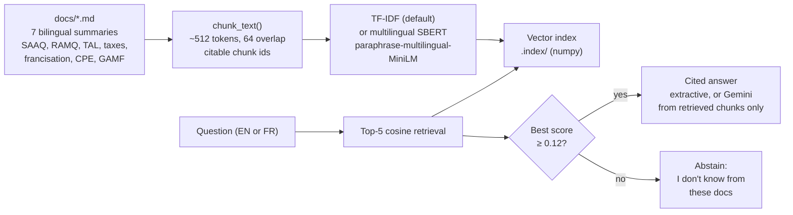

# Quebec Newcomer Survival Bot

A Retrieval-Augmented Generation (RAG) bot that answers newcomer questions
about Quebec — driver's licence (SAAQ), health insurance (RAMQ), tenant
rights, taxes, free French courses, childcare, and finding a doctor — **with
citations, and with an explicit "I don't know" when the docs don't cover it.**

> **Not legal, tax, or medical advice.** The docs in `docs/` are paraphrased,
> bilingual summaries written for this project, not copies of official pages.
> Always check the official source in `docs/sources.md` before acting, because
> rules, deadlines, and fees change. No TELUS or client data is used anywhere
> in this repo — only public-topic summaries and synthetic eval questions.

## Quickstart (3 commands)

```bash
pip install -r requirements.txt
python rag.py index
python rag.py ask "How do I exchange my foreign driver's licence in Quebec?"
```

No API key needed: the default answer is **extractive** — it shows you the
exact doc chunks it used, with citations like
`[saaq-permis-de-conduire.md#chunk-0]`.

For a generated answer instead, set a Gemini key and ask again:

```bash
export GEMINI_API_KEY="..."
python rag.py ask "Comment échanger mon permis de conduire ?"
```

## Architecture



Why this shape, in one paragraph each:

- **Bilingual docs, cross-lingual questions.** A newcomer often asks in
  English about a French-language system. That is the hard part of this bot,
  and the eval measures it separately by question language.
- **Citations, not confidence.** Every factual claim points to a
  `source#chunk-n` the user can open. If Gemini is enabled, the prompt
  forbids facts outside the retrieved chunks.
- **Abstention as a feature.** A wrong confident answer about a licence
  deadline or a lease is worse than no answer. The threshold gate is tested
  with out-of-scope questions (passport renewal, weather, a US work visa).

## Results (measured, 2026-10-29)

Eval set: `eval/questions.json` — 20 in-scope questions (13 English, 7 French)
plus 4 out-of-scope abstention questions. Run with:

```bash
python eval.py                          # 512-token chunks
python eval.py --chunk-tokens 256       # chunk-size comparison
```

| Chunk size | Chunks | Hit@1 | Hit@5 | MRR | Abstention (4/4 = 1.0) |
|---|---:|---:|---:|---:|---:|
| **512 tokens (default)** | 7 | **1.00** | **1.00** | **1.00** | **1.00** |
| 256 tokens | 16 | 1.00 | 1.00 | 1.00 | 0.75 |

Hit@5 by language at 512 tokens: English 1.00, French 1.00.

**Read this honestly:** this is a small, in-repo eval set (24 questions) on
short summary docs, so 1.00 means "the pipeline works end to end," not
"production-ready." The interesting finding is the trade-off in the second
row: smaller chunks keep retrieval perfect but let one out-of-scope question
(weather) slip past the threshold at 0.123, while 512-token chunks keep
abstention perfect. That is why 512 is the default here, and why the
threshold is a tuned parameter, not a magic number.

**Not yet measured — do not quote:** multilingual SBERT embeddings. To fill
that column in, run:

```bash
pip install sentence-transformers
python eval.py --embedder sbert
```

The hypothesis to test: SBERT should beat TF-IDF on French-only questions
asked in English, where exact-token matching is weakest. Until that run
exists, no SBERT number is claimed in this README.

## Project structure

```
rag.py                  # load, chunk, TF-IDF/SBERT, retrieve, answer, CLI
eval.py                 # Hit@1/Hit@5/MRR + abstention accuracy
eval/questions.json     # 24 questions with expected sources
eval/results.json       # latest measured results (512 tokens)
docs/                   # 7 bilingual summaries + sources.md
requirements.txt        # numpy only by default; Gemini/SBERT are optional
```

## Try it

```bash
python rag.py ask "Can a Quebec landlord ask for a cash security deposit?"
python rag.py ask "Comment s'inscrire à un cours de francisation ?"
python rag.py ask "How do I renew my American passport in Montreal?"  # should abstain
```

## What's next (the portfolio story)

This is Project 1 of 3. The planned follow-ups build on this repo, not
beside it:

- **Project 2 — agentic-migration-sandbox:** an agent that investigates a
  simulated incident using this bot's retrieval, with guardrails.
- **Project 3 — llm-serving-vllm:** a self-hosted open model (vLLM) that
  could power this bot, with TTFT / inter-token latency metrics.

## Contributing / extending

- Add a doc: drop a Markdown file in `docs/`, add its official URL to
  `docs/sources.md`, add 2–3 questions to `eval/questions.json`, re-run
  `python eval.py`, and update the table above with the new numbers.
- Swap the embedder: `--embedder sbert` (see above). Swap the generator:
  `GEMINI_API_KEY` (see Quickstart). Swap the chunker for a real tokenizer
  (tiktoken) if you need exact token counts — the current chunker
  approximates 512 tokens as ~384 words and says so in `rag.py`.
